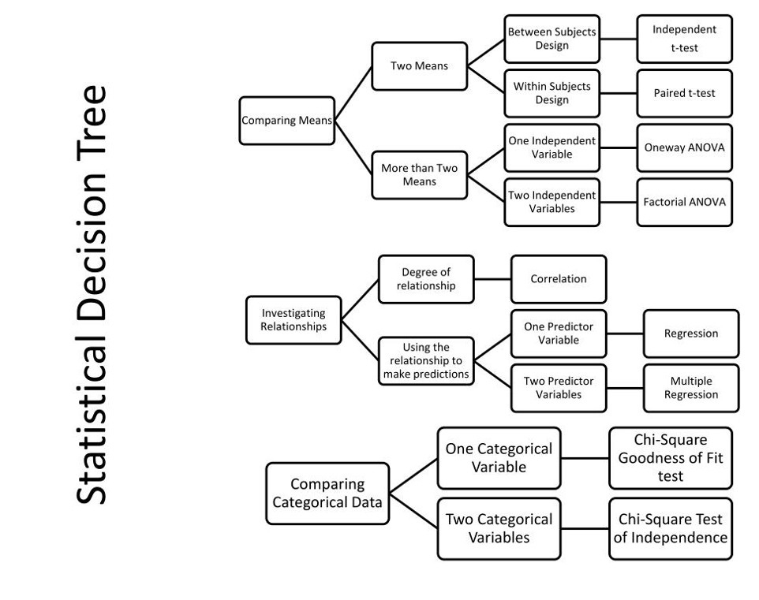

## Reflecting on last week's task: the rationale

- What challenges did you have when writing the rationale?
- Did you have any successes?
- What might you do differently next time?
- What skills have you learned?
- How might you apply them to your future career?

{fig-align="center" width="300"}

---

## Peer support on your rationale

- Please exchange your rationale with another person.

. . .

- Read their rationale and provide feedback.

. . .

{fig-align="center" width="500"}

---

## Reflection on peer support

- Were there any common issues that you both noticed?

. . .

- What kinds of recommendations did your peer supporter provide?

. . .

- What are you going to do with the feedback?

{fig-align="center" width="300"}

---

## Study design

**Things to consider when choosing your design:**

- Which design fits the hypothesis you want to test?

. . .

- Consider:
  - The type of study that is appropriate
  - Practicality (measurement, number of participants, analysis)
  - Which type of analysis should I use to answer my research question?
  - What could be some potential problems?

{fig-align="center" width="350"}

---

## Study design (continued)

- Spend 10 minutes discussing your design ideas with your partner.

- Some of this will be easy: if you are doing a replication study, you will be doing something as close to the original as possible!

{fig-align="center" width="450"}

---

## Participants

- Who do you want to recruit?

. . .

- How many do you think you need?

. . .

- How will you recruit them?

. . .

- Do you have a backup plan if you run into issues?

{fig-align="center" width="300"}

---

## Interventions

- Some studies involve an intervention.
  - E.g., participants complete some surveys, do an hour of mindfulness, then complete the surveys again.

. . .

- Does your idea involve an intervention?
  - If so, what does it look like, how is it delivered, etc.?
  - Do you think this is feasible for your project in the timeframe?

{fig-align="center" width="300"}

---

## Survey measures {.smaller}

- Which one to pick?

  - In your literature review, is there one scale that is used by most researchers?

. . .

  - Is it practical? (Length, language, applicability)

. . .

  - Can you find it online?
    - How do you find an actual copy of it?
    - Is it in any of the papers that mention it?
    - Is it in any of the appendices/supplementary materials?
    - What about the original article it comes from?
    - Try the [OSF](https://osf.io).
    - Try the resources provided by your module tutor.
    - Literally 'having a Google' brings up a surprising number of resources!

{fig-align="center" width="200"}

---

## Designing items

- We would only do this if there is nothing close that is 'good enough'.
- But sometimes you just need to ask about one thing, or there is no scale for what you are interested in.
- Things to consider:
  - Is it easy for my target audience to read and understand?
  - What type of response options should I use?
  - What type of data will this question give me?
  - More importantly, can I analyse it?

---

## Other measures

- Some studies involve other measures.
  - E.g., a reaction time task, a reading task, a driving simulator.

. . .

- If you are using one of these, does it exist already?

. . .

- If it is new, what is it going to look like, and how are you going to create it?

. . .

- What sort of data does this produce, and how will you analyse it?

---

## Procedure

- Have a clear idea of what will happen in your study.

. . .

- You need to know everything that both the researcher and the participant are required to do.

. . .

- Set this out as a timeline with at least two columns: participant and researcher.

{fig-align="center" width="275"}

---

## Analysing your data

**Again, this is easier if you are doing a replication project!**

- Before you start doing anything, have a good idea of what the data and analysis will look like.

. . .

- Before collecting data, you must know what to do with it.
  - E.g., you know you need to run a regression, and you know how to turn a spreadsheet of raw data into an output you can report from.

. . .

- The next slide has a flowchart to help you identify an analysis.

. . .

- This is a good general overview, but you need to know how your data will work in reality.

{fig-align="center" width="100"}

---

## (Grossly oversimplified) statistical decision tree

{fig-align="center" width="700"}

---

## Ethical considerations

- What ethical considerations do you have?

. . .

- We recommend avoiding high-risk studies, as the ethics process is longer and can hold you up.

. . .

- We can talk this through and see how we can reduce the ethical risk.

. . .

- Some groups are automatically high risk (e.g., children or people with specific diagnoses).

{fig-align="center" width="200"}

---

## It's your turn!

- Work with your partner to design your study, find measures, and decide which analysis to use.

{fig-align="center" width="400"}

---

## For next time...

- Bring a clear design for your project.

. . .

- We will use this to start the ethics form next week, but you can already start on it now!

{fig-align="center" width="500"}

---

## References (and further reading) {.smaller}

- Cohen, L., Manion, L., & Morrison, K. (2018). *Research methods in education* (8th ed.). Routledge. <https://doi.org/10.4324/9781315456539>
- Coolican, H. (2019). *Research methods and statistics in psychology* (7th ed.). Routledge. <https://doi.org/10.4324/9781315201009>
- Creswell, J. W., & Creswell, J. D. (2018). *Research design: Qualitative, quantitative, and mixed methods approaches* (5th ed.). SAGE Publications.

<https://tvpollet.github.io/thesis_projects/>
